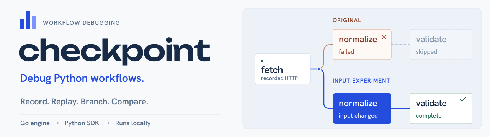
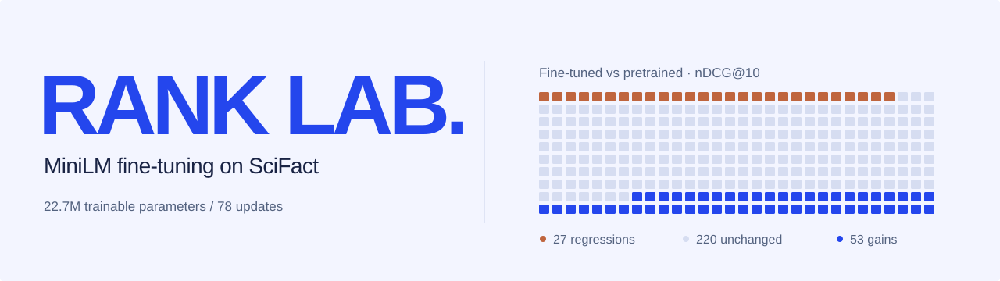

# Shayan Ali

I like building things, trying out ideas and getting to the bottom of how they work. I'm interested
in the whole process: the code, the interface, the systems underneath, and what happens when
something goes wrong.

Lately, I've been building a workflow debugger in Go and Python, training retrieval models and
contributing fixes to open-source projects. Have a look around.

Australia · **[LinkedIn](https://www.linkedin.com/in/shayan-ali-776590339/)**

## Checkpoint

I built Checkpoint to investigate failed Python workflows without losing the inputs and
responses that explain the failure. Record a run, replay supported HTTP calls, branch with a
changed input, and compare the result while keeping the original run intact.

The Go engine runs the workflows, a Python SDK connects your code, and the interface brings
the execution path, attempts and JSON differences together. Run history persists in SQLite;
selected code and recordings can be exported as an executable reproduction. Windows and
Linux releases include the interface, examples and SDK.

**[Try Checkpoint](https://shayanxcyber.github.io/checkpoint/)** ·
[Source](https://github.com/shayanxcyber/checkpoint) ·
[Architecture](https://github.com/shayanxcyber/checkpoint/blob/main/docs/architecture.md) ·
[Watch demo](https://github.com/shayanxcyber/checkpoint#readme-ov-file)

Go · Python · React · TypeScript · SQLite

## Rank Lab

Rank Lab fine-tunes MiniLM on SciFact and compares its search results with pretrained and
keyword-search baselines. It records checkpoints, resumes interrupted training and lets you
inspect the documents behind each query’s score.

**22.7M trainable parameters · 3 epochs · 78 updates · +3.00 pp nDCG@10 over pretrained.**
The explorer keeps all 53 gains and 27 regressions visible. The result is from one SciFact study;
you can also train on your own documents and open the exported results in the same explorer.

**[Open explorer](https://shayanxcyber.github.io/rank-lab/)** ·
[Source](https://github.com/shayanxcyber/rank-lab) ·
[Engineering decisions](https://github.com/shayanxcyber/rank-lab/blob/main/docs/CASE-STUDY.md) ·
[Watch demo](https://github.com/shayanxcyber/rank-lab#demo)

Python · PyTorch · React · TypeScript

## Evidence Atlas

An investigation workspace for engineering sources that change or disagree. Trace passages to
retained versions and line numbers, compare revisions, and keep supporting and contradictory
evidence attached to a conclusion. Includes a runnable fictional investigation and retrieval checks.

[Project](https://github.com/shayanxcyber/evidence-atlas) ·
[Case study](https://github.com/shayanxcyber/evidence-atlas/blob/main/docs/CASE-STUDY.md) ·
[Watch demo](https://github.com/shayanxcyber/evidence-atlas#demo)

React · TypeScript · Python · FastAPI · SQLite / FTS5

### Other projects

- **[Reliable Replay Lab](https://github.com/shayanxcyber/reliable-replay-lab)**: Python/SQLite experiments for retries, stable operation identities and recovery after a worker crash.
- **[LUNEA Commerce](https://github.com/shayanxcyber/E-commerce-Fullstack-Website)**: an individual React/Express/MongoDB project with authentication, access controls and customer/admin workflows. [Live demo](https://shayanxcyber.github.io/E-commerce-Fullstack-Website/)

## Open-source contributions

- **[Qdrant client #1563](https://github.com/qdrant/qdrant-client/pull/1563) · Merged**: fixed migration retries that could lose records after a failed upload.
- **[REA #1829](https://github.com/morluto/rea/pull/1829) · Merged**: reused parsed module URLs during matching to avoid repeated parsing.

## Background

UTS Bachelor of Cybersecurity, expected 2027 · **GPA 6.60/7.00** · **Dean's List 2025 & 2026**.
At Zip, I built a JavaScript proof of concept and worked on Angular/TypeScript features during
an internal Software Developer trial, alongside experience in regulated financial-services operations.

**Working with:** Go, Python/PyTorch, TypeScript, React/Angular, REST APIs, SQL, Linux and automated tests.
Open to graduate and junior technology roles in Australia.

Security, infrastructure and earlier projects

- [IDOR analysis and defence](https://github.com/shayanxcyber/Vulnerability-Analysis-and-Defense-IDOR): a two-person investigation of object-level access control and layered defences.
- [PKI and HTTPS](https://github.com/shayanxcyber/HTTPS-Server-PKI-Project): a private CA, X.509 certificates and TLS trust validation in a lab.
- [VMware vSphere labs](https://github.com/shayanxcyber/VMware-vSphere-Lab-Projects): ESXi, storage, networking, vMotion and High Availability.
- [Database design](https://github.com/shayanxcyber/Real-Estate-Database-Design-Project): a two-person ERD and PostgreSQL implementation.

